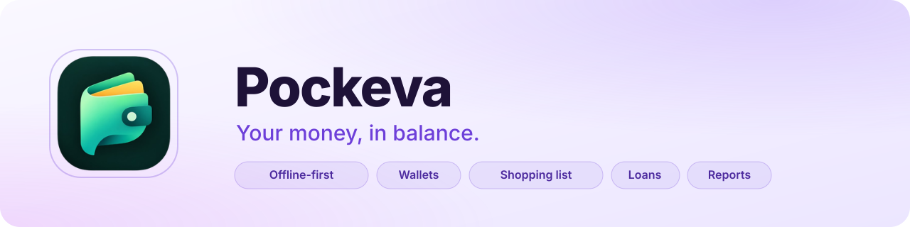
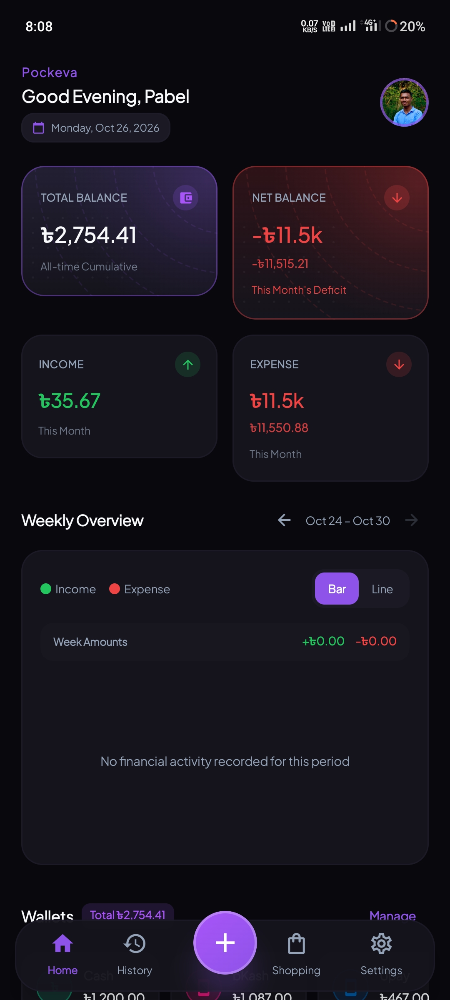
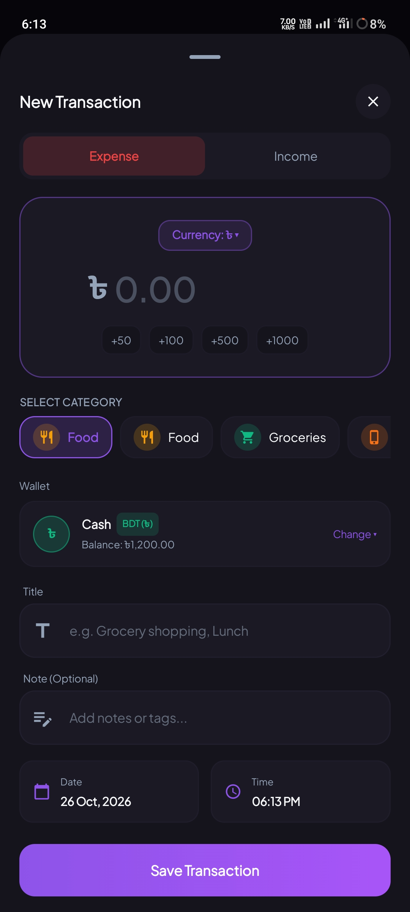
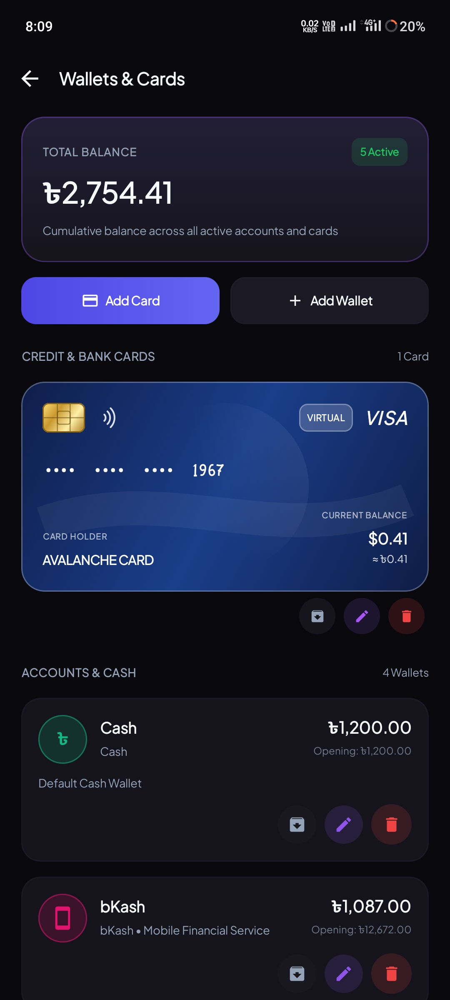
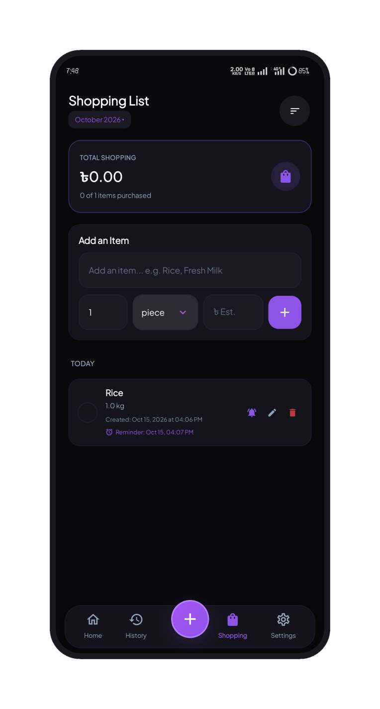
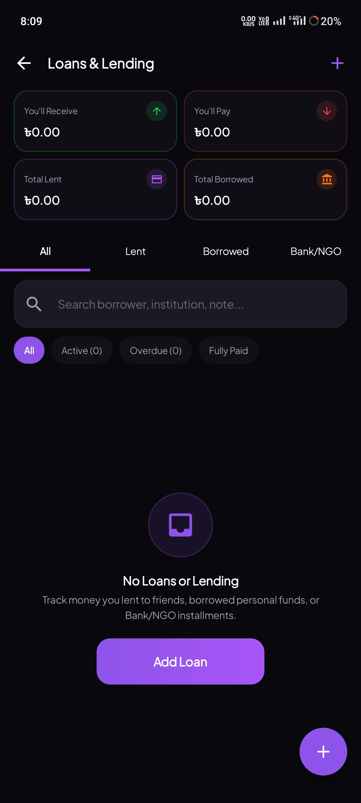
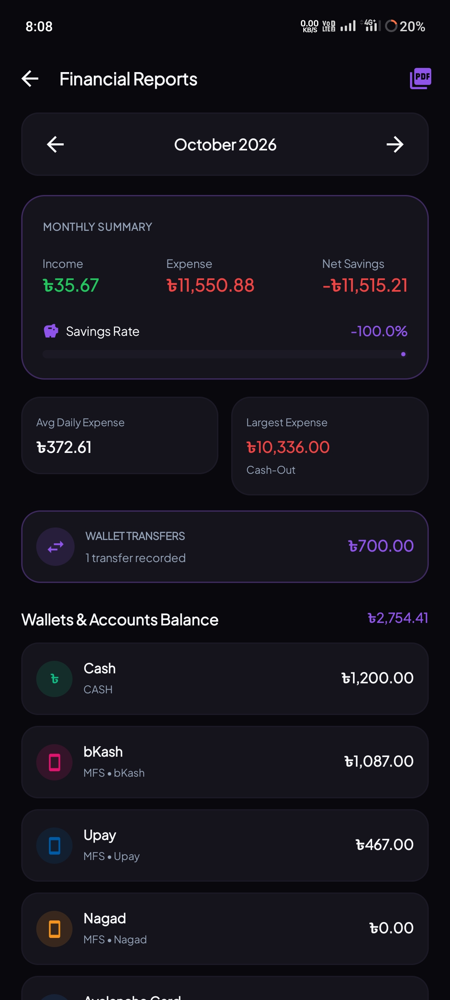
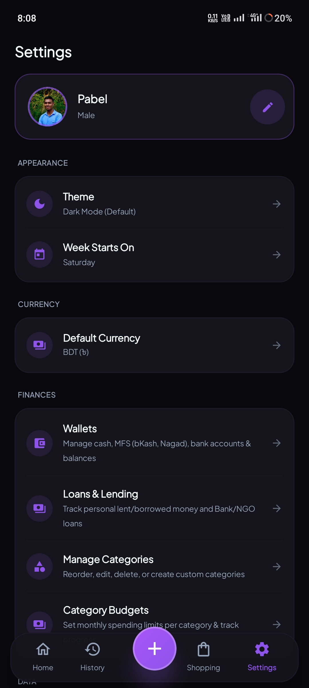

  <picture>
    <source media="(prefers-color-scheme: dark)" srcset="Assets/banner-dark.svg">
    
  </picture>

  <h3>An offline-first personal finance app for Android.</h3>

  

    
    
    
    
  

  

    
    
    
    
    
  

  

    Pockeva helps you organize everyday finances in one place. 
    Wallets, income and expenses, shopping lists, loans and reports, all stored on your device.
  

  

    <a href="https://github.com/itspabel/Pockeva/releases/latest"><b>Download APK</b></a> ·
    <a href="https://pockeva.asf.run"><b>Website</b></a> ·
    <a href="https://github.com/itspabel/Pockeva/issues/new/choose"><b>Report a Bug</b></a> ·
    <a href="#support-development"><b>Support</b></a>
  

---

## 💡 Why Pockeva?

Most finance apps want an account, an internet connection and a slice of your data. Pockeva is built the other way around. It works without an internet connection, needs no registration, and keeps supported financial records in a local database on your phone.

You decide where backups go, you can export reports as PDF, and you can wipe everything at any time.

---

## ✨ Features

### 💰 Income & Expense Tracking
- Record income and expenses.
- Organize transactions using categories.
- Review and manage transaction history.
- Monitor your financial activity.

### 👛 Wallet Management
- Create and manage multiple wallets.
- Organize cash, mobile financial services, bank accounts, and custom wallets.
- Select a wallet when recording income or expenses.
- View balances maintained for individual wallets.

> Wallet balances are recorded in Pockeva and are not automatically verified against financial service providers.

### 🛍️ Shopping List
- Add shopping items with quantities and units.
- Mark items as purchased and record purchase costs.
- Review shopping activity and history.
- Receive reminders when supported by device settings and notification permissions.

### 🤝 Borrowing, Loans & Lending
- Record money borrowed from other people.
- Keep records of money lent to others.
- Organize borrowing and lending information.
- Track relevant amounts using the fields available in the app.

### 📊 Reports & Financial Insights
- Review available financial summaries and charts.
- Monitor income, expenses, and balances.
- Export supported financial reports as PDF files.

### 💾 Backup & Restore
- Create local JSON backups of supported app data.
- Restore data using the app's supported import process.
- Choose where exported files are saved.

### 🎨 Personalization
- Manage your profile.
- Use supported light and dark themes.
- Customize available app preferences.

---

## 📸 Screenshots

  <table>
    <tr>
      <td align="center"><b>Dashboard</b> </td>
      <td align="center"><b>Transactions</b> </td>
      <td align="center"><b>Wallets</b> </td>
    </tr>
  </table>
  

    
<b>More screenshots</b>

    <table>
      <tr>
        <td align="center"><b>Shopping List</b> </td>
        <td align="center"><b>Borrowing & Lending</b> </td>
        <td align="center"><b>Reports</b> </td>
      </tr>
      <tr>
        <td align="center"><b>Settings</b> </td>
        <td align="center"></td>
        <td align="center"></td>
      </tr>
    </table>
  

---

## 🆕 What's New

<!-- release-notes:start -->
### v1.1.0

- Added live confirmation preview dialogs with short Confirm actions across Wallet & Card creation/editing, Transactions, Transfers, Conversions, Withdrawals, and Loans.
- Upgraded Success dialogs with context-aware animated vector hero badges, operation-specific detail summaries, and live Before -> After wallet balance cards.
- Enhanced Financial Reports with an Income vs Expense Bar/Trend chart, interactive Savings Rate progress gauge, and expanded daily & monthly cashflow highlights.
- Added a Repeat action in Transaction Details to quickly prefill a new entry with today's date, plus an Exit Pockeva confirmation dialog on Home Back navigation.
- Added a Share App button in Settings sharing itspabel.github.io/Pockeva, updated the Support card with a Coffee icon, and ensured crisp vector icons across all alerts.

[View full release](https://github.com/itspabel/Pockeva/releases/latest)
<!-- release-notes:end -->

Older versions are listed in [release-notes.md](release-notes.md).

---

## 📥 Download

  
  

#### Which APK should I download?

Each release has three APKs.

| Your device | File |
| :--- | :--- |
| Any device (recommended, works everywhere) | `Pockeva-v1.1.0-universal.apk` |
| Most modern phones (64-bit, `arm64-v8a`), smaller download | `Pockeva-v1.1.0-arm64-v8a.apk` |
| Older 32-bit phones (`armeabi-v7a`) | `Pockeva-v1.1.0-armeabi-v7a.apk` |

Not sure which one to pick? Choose the **universal** APK.

### 📲 How to install

1. Open the [latest release page](https://github.com/itspabel/Pockeva/releases/latest) and download the APK.
2. When the download finishes, your browser may ask whether to keep the file. Choose **Keep** or **Save**.
3. Open the downloaded file and tap **Install**.
4. If Google Play Protect shows a scan option, tap **Scan app** and let it finish.
5. If Android says the app is blocked or from an unknown source, tap **More details**, then **Install anyway**. You may also need to allow installs from the app you used to download the APK.
6. Open Pockeva.

Prefer automatic updates? Add Pockeva to [Obtainium](https://github.com/ImranR98/Obtainium) with the Obtainium badge above.

Only install APK files from sources you trust. Official downloads are published only on the [Releases page](https://github.com/itspabel/Pockeva/releases) and the [Pockeva website](https://pockeva.asf.run).

---

## 💰 Support Development

Pockeva is free to download and is built independently. If it helps you stay in balance, please consider supporting the developer so development can keep going.

---

## 🔒 Privacy

Pockeva:

- Is designed to operate without an internet connection.
- Stores supported financial records, categories, budget calculations, and shopping lists in a local SQLite database in the app's internal storage.
- Keeps profile information and the photo selected through Android's Photo Picker on the device.
- Does not require account registration, an email address, or a phone number.
- States that it does not include analytics SDKs, advertising networks, telemetry, or crash trackers.
- Generates JSON backups and PDF reports locally when requested.

These statements reflect the supplied in-app Privacy Policy. Refer to the policy included with the exact app version you install. See also [privacy.md](privacy.md).

## 🛡️ Data Safety

- Financial records and wallet balances depend on information entered by the user.
- Local app data may be lost if you uninstall the app, clear its storage, or lose access to your device.
- Shopping reminders depend on notification permissions and Android settings.
- Backup files may contain sensitive financial information. Store them securely.

**Create a backup before uninstalling Pockeva or moving to another device.**

---

## 🐞 Bug Reports & Feature Requests

Found a problem or have a feature suggestion? [Open a GitHub issue](https://github.com/itspabel/Pockeva/issues/new/choose) and pick the matching form.

When reporting a bug, include:
- Pockeva version or release tag
- Android version and device model
- Steps to reproduce the issue
- Expected behavior and actual behavior
- Screenshots, if relevant

Do not post passwords, financial account credentials, or private backup files in public issues.

Security problems should be reported privately, see [SECURITY.md](SECURITY.md). More about how to help: [CONTRIBUTING.md](CONTRIBUTING.md).

---

## 📄 Copyright & License

Copyright © 2026 Pockeva. All rights reserved.

Pockeva, including its application package (APK), branding, logos, graphics, and associated project materials, is proprietary software.

No permission is granted to copy, modify, redistribute, reverse engineer, or create derivative works from these materials, except where applicable law expressly permits or the copyright owner provides prior written permission.

For licensing or redistribution inquiries, please contact the copyright owner.

This repository does not grant an open-source license.

## ⚠️ Disclaimer

Pockeva is a personal finance record-keeping tool. It is not a bank, payment processor, lender, or financial adviser. Wallet balances and financial records are not official or independently verified account statements.

---

**Pockeva. Your money, in balance.**

[Download the Latest Release](https://github.com/itspabel/Pockeva/releases/latest) · [Website](https://pockeva.asf.run) · [Support](https://itspabel.github.io/Donate)

