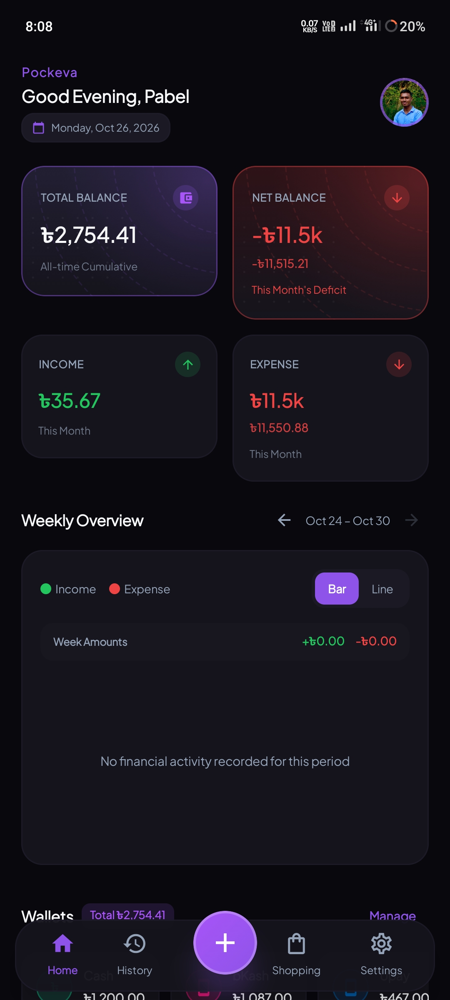
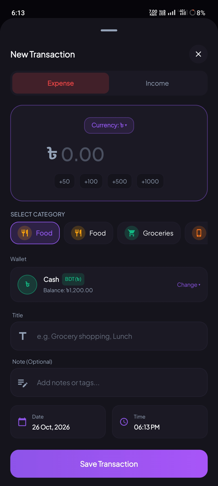
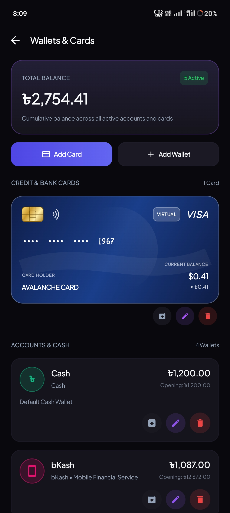
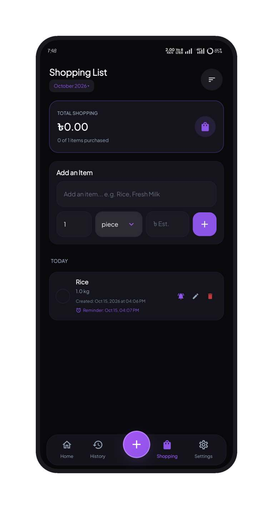

# Pockeva

### Your money, in balance.

**An offline-first personal finance app for Android.**

)

[Download Pockeva](https://github.com/itspabel/Pockeva/releases/download/v1.0.3/Pockeva-v1.0.3-universal.apk) · [Report a Bug](https://github.com/itspabel/Pockeva/issues)

---

## About Pockeva

Pockeva helps you organize your everyday finances in one place. Track income and expenses, manage wallets, maintain shopping lists, review financial reports, and record money borrowed or lent.

Designed for offline use, Pockeva stores supported financial records locally on your device.

## Features

### 💰 Income & Expense Tracking
- Record income and expenses.
- Organize transactions using categories.
- Review and manage transaction history.
- Monitor your financial activity.

### 👛 Wallet Management
- Create and manage multiple wallets.
- Organize cash, mobile financial services, bank accounts, and custom wallets.
- Select a wallet when recording income or expenses.
- View balances maintained for individual wallets.

> Wallet balances are recorded in Pockeva and are not automatically verified against financial service providers.

### 🛍️ Shopping List
- Add shopping items with quantities and units.
- Mark items as purchased and record purchase costs.
- Review shopping activity and history.
- Receive reminders when supported by device settings and notification permissions.

### 🤝 Borrowing, Loans & Lending
- Record money borrowed from other people.
- Keep records of money lent to others.
- Organize borrowing and lending information.
- Track relevant amounts using the fields available in the app.

### 📊 Reports & Financial Insights
- Review available financial summaries and charts.
- Monitor income, expenses, and balances.
- Export supported financial reports as PDF files.

### 💾 Backup & Restore
- Create local JSON backups of supported app data.
- Restore data using the app's supported import process.
- Choose where exported files are saved.

### 🎨 Personalization
- Manage your profile.
- Use supported light and dark themes.
- Customize available app preferences.

## Screenshots

  
  
  
  

## Installation

1. Visit the [Pockeva v1.0.3 release page](https://github.com/itspabel/Pockeva/releases/tag/v1.0.3).
2. Download the APK from the release assets.
3. Open the APK on your Android device.
4. If prompted, allow installation from the source used to download the APK.
5. Complete installation and launch Pockeva.

Only install APK files from sources you trust.

## Privacy

Pockeva:

- Is designed to operate without an internet connection.
- Stores supported financial records, categories, budget calculations, and shopping lists in a local SQLite database in the app's internal storage.
- Keeps profile information and the photo selected through Android's Photo Picker on the device.
- Does not require account registration, an email address, or a phone number.
- States that it does not include analytics SDKs, advertising networks, telemetry, or crash trackers.
- Generates JSON backups and PDF reports locally when requested.

These statements reflect the supplied in-app Privacy Policy. Refer to the policy included with the exact app version you install.

## Data Safety

- Financial records and wallet balances depend on information entered by the user.
- Local app data may be lost if you uninstall the app, clear its storage, or lose access to your device.
- Shopping reminders depend on notification permissions and Android settings.
- Backup files may contain sensitive financial information. Store them securely.

**Create a backup before uninstalling Pockeva or moving to another device.**

## Bug Reports & Feature Requests

Found a problem or have a feature suggestion?

[Open a GitHub issue](https://github.com/itspabel/Pockeva/issues).

When reporting a bug, include:
- Pockeva version or release tag
- Android version and device model
- Steps to reproduce the issue
- Expected behavior and actual behavior
- Screenshots, if relevant

Do not post passwords, financial account credentials, or private backup files in public issues.

## Copyright & License

Copyright © 2026 Pockeva. All rights reserved.

Pockeva, including its application package (APK), branding, logos, graphics, and associated project materials, is proprietary software.

No permission is granted to copy, modify, redistribute, reverse engineer, or create derivative works from these materials, except where applicable law expressly permits or the copyright owner provides prior written permission.

For licensing or redistribution inquiries, please contact the copyright owner.

This repository does not grant an open-source license.

## Disclaimer

Pockeva is a personal finance record-keeping tool. It is not a bank, payment processor, lender, or financial adviser. Wallet balances and financial records are not official or independently verified account statements.

---

**Pockeva — Your money, in balance.**

[Download the Latest Release](https://github.com/itspabel/Pockeva/releases/tag/v1.0.3) · [GitHub Repository](https://github.com/itspabel/Pockeva)

